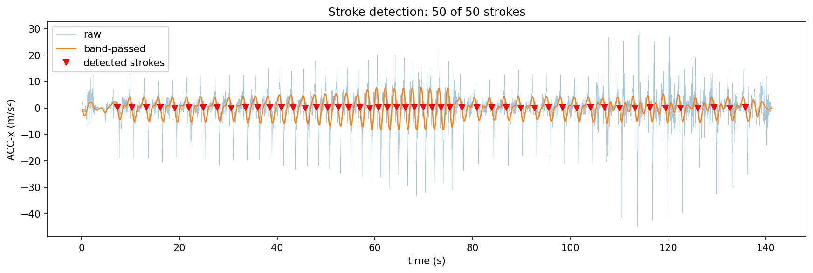
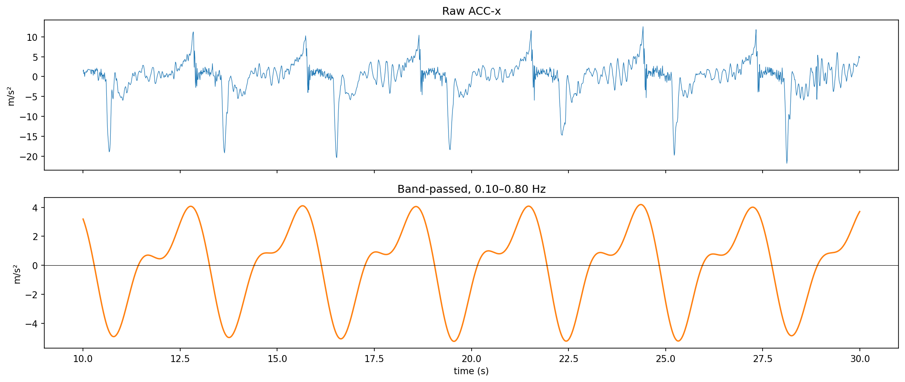
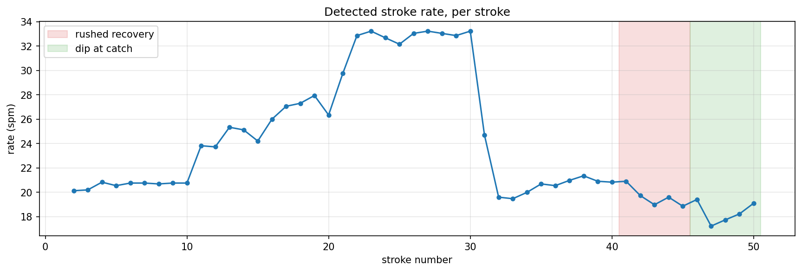
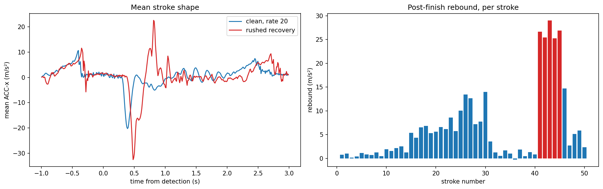
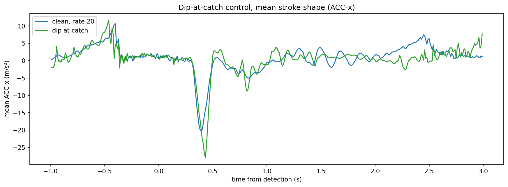

# Rowing Telemetry Handle

**A retrofittable, telemetry-enabled rowing oar handle — bringing stroke kinematics to crews who can't afford elite instrumentation.**

Elite rowing programmes measure their athletes in fine detail: catch and finish timing, blade height, feathering, and how well a crew moves as one. That data lives behind expensive, boat-specific instrumentation. Everyone below the top tier rows largely blind. This project asks whether the same insight can be delivered by a handle that slots onto a standard sweep oar — no boat modifications, no elite budget — pairing a sealed sensor handle with a coach-facing dashboard.

The work is deliberately structured as a sequence of cheap experiments, each one earning the right to spend on the next. This repository documents that sequence as it happens. **Stage 0 — offline stroke detection — is complete, and is written up in full below.**

---

## Project status

| Stage | What it proves | Status |
|-------|----------------|--------|
| **0. Offline stroke detection** | A commodity phone IMU can reliably detect strokes and timing faults — before any hardware spend | ✅ **Complete (this document)** |
| 1. On-water validation | The stroke signal survives the move from erg to water; blade-height faults become visible | ⏳ In progress |
| 2. Metrics pipeline | Raw motion → coaching numbers (catch/finish angle, rate, height, crew sync) | Planned |
| 3. Live firmware + BLE | Stream live off a moving oar instead of record-and-analyse | Planned |
| 4. Sealed handle prototype | A custom, waterproof, wirelessly-charged handle that functions like stock | Planned |
| 5. Field pilot | Real crews, a full season — durability, and whether coaches actually reach for it | Planned |
| 6. Coach dashboard | The recurring-revenue software half: history, multi-crew, comparison | Planned |
| 7. Commercialisation | FTO opinion, design-for-manufacture, go-to-market | Planned |

---

# Stage 0 — Offline Stroke Detection

## Summary

Before committing any money to hardware, I set out to answer the cheapest possible version of the core question: **can a commodity smartphone IMU detect individual rowing strokes reliably, and can it surface basic stroke-timing faults?** Using an iPhone taped to an erg handle and an offline analysis script, the answer on this recording is yes.

Working from a single continuous recording — a rate ladder followed by two deliberately injected faults — a band-pass filter and a zero-crossing detector with hysteresis found all 50 strokes. A rushed-recovery fault stood out in all five affected strokes through a large acceleration rebound after the finish. It did **not** appear as a change in stroke rate. A hand-dip fault was included as a control and showed no dip-specific signature in the drive-axis signal.

The first version of the pipeline did not get this right: it counted the fault strokes twice, which looked like a 40 spm rate spike that never happened. That failure and its fix are documented below.

This stage validates the **detection approach** on one recording from one rower. It does not yet prove that the approach generalises or survives the move to open water.

## The question this stage answers

Everything downstream of here — custom hardware, waterproofing, a dashboard, a business — is expensive and slow. None of it is worth starting if the fundamental premise fails: that cheap, low-grade motion data carries enough signal to be useful to a coach.

So Stage 0 isolates the single riskiest assumption and tests it for almost nothing:

> Can offline motion data from a phone-grade IMU reliably segment a rowing piece into individual strokes, and distinguish good strokes from specific, named faults?

If that fails, the whole idea fails cheaply and early. If it works, it earns the right to spend on Stage 1.

## Scope — and why it's deliberately narrow

Every constraint here is a choice, not a limitation I failed to overcome:

- **Erg, not water.** An ergometer is a free, repeatable, controllable test rig. It lets me inject faults on demand and record clean baselines without weather, boat access, or risk to equipment.
- **Phone IMU, not custom hardware.** The point is to test the *idea* before paying for the *thing*. A phone already contains an accelerometer and gyroscope good enough to ask the question.
- **Offline, not live.** Record-then-analyse removes every real-time engineering concern (firmware, BLE, latency) so I can focus purely on whether the signal is there.
- **Detection and timing, not force.** Force measurement needs a load sensor and is explicitly deferred to a later phase. Stage 0 is about kinematics only.

The goal of Stage 0 is not to build the product. It is to de-risk it.

## Method

### Setup

- **Device:** iPhone 13
- **Recording app:** Sensor Logger (v1.62), logging at a nominal **100 Hz**. The exported data measures **99.68 Hz** with evenly spaced samples and no dropouts.
- **Channels captured:** calibrated and uncalibrated accelerometer and gyroscope, plus gravity and device orientation
- **Mounting:** the phone was taped flat to the handle, screen up, with the camera end pointing left and the charging-port end pointing right — fixing the phone's axes relative to the handle for the entire piece. In this orientation the drive direction runs along the phone's **x-axis**, referred to throughout as **ACC-x**.

### A key point about which axis carries the signal

On an ergometer, the handle travels **back and forth in a straight line**. The stroke therefore lives in **linear acceleration along the drive axis** (ACC-x).

This matters enormously for what comes later. **On the water, the oar does not translate in a line — it pivots about the pin.** There, the stroke signal is predicted to live in **yaw rate**, not linear acceleration. Recognising this now is what makes Stage 1's central test precise: it is not "does detection still work," it is "does the signal move to the axis I predict, and does detection follow it there." Stage 0 establishes the method on the axis the erg exposes; Stage 1 tests whether it transfers.

### The recording

The whole protocol lives in **one continuous recording**, bracketed by sharp taps of the handle at the start and end. Everything in between was rowed at **backstops** — the handle drawn to the chest at the finish position, matching how the handle sits when used on the water — across six phases run back to back:

| Phase | Strokes | Target rate (spm) | Measured median (spm) | Purpose |
|-------|---------|-------------------|-----------------------|---------|
| 1 | 10 | 20 | 20.8 | Rate ladder — baseline detection |
| 2 | 10 | 26 | 26.0 | Rate ladder |
| 3 | 10 | 32 | 33.0 | Rate ladder — top of range |
| 4 | 10 | 20 | 20.7 | Return to baseline |
| 5 | 5 | 20 | 19.3 | **Rushed-recovery fault** |
| 6 | 5 | 20 | 18.0 | **Dip-at-catch fault** |

Phases 1–4 test whether detection holds across cadence. Phase 2 was not perfectly steady: the rate climbed from about 24 to 28 spm, so 26.0 is its median rather than a held rate.

For reproducibility, the faults were rowed as follows:

- **Rushed recovery:** arms rushed away, a slow rock-over, then a rushed slide into the catch.
- **Dip at catch:** some strokes dipped the hands early on the recovery, others dipped right at the catch.

Phases are assigned by stroke order, using the protocol's 10, 10, 10, 10, 5, 5 structure.

## The detection pipeline

The pipeline is intentionally simple:

1. **Isolate ACC-x.** The drive-axis acceleration is where the stroke lives on an erg.

2. **Band-pass filter, 0.10–0.80 Hz.** Stroke rates of 20–32 spm correspond to roughly 0.33–0.53 Hz. The low cut-off removes slow drift, and the high cut-off removes the sharp impacts and fast noise that would otherwise trigger false crossings. A third-order Butterworth filter is applied forwards and backwards with `sosfiltfilt`, so it adds no time delay.

3. **Downward zero-crossing detection.** Each stroke is marked where the filtered signal crosses from positive to negative. This crossing is steep, which makes its timing less sensitive to small offsets.

4. **Hysteresis.** A crossing only counts if the filtered signal then reaches −3 m/s² within 0.8 s. This rejects the shallow false crossings described below.

5. **Refractory period, 1.3 s.** After each detected stroke, further detections are suppressed for 1.3 s. It is kept as a safeguard, although no crossing on this recording fell inside it.

The script also trims the recording to the rowing window, 5.0–137.5 s, to exclude the taps.

### The failure that shaped the final pipeline

The first run, without hysteresis or trimming, produced **61 detections for 50 strokes**. One came from the opening taps, and the 40 rate-ladder strokes were correct. The other 20 came from the 10 fault strokes and closing taps.

In that section, detections arrived about 1.5 s apart, which looked like 40 spm. The raw signal showed why that was wrong: large spikes were still about 3 s apart. The violent fault strokes pushed a shoulder in the filtered waveform below zero, creating a second crossing per stroke. At about 0.67 Hz, that extra oscillation sits inside the filter's pass band, and at 1.5 s it also gets past the 1.3 s refractory period.

Raising the refractory period was not a good fix, because it would soon begin blocking real high-rate strokes. Hysteresis removes the false crossings without limiting the rate.

**Result:** the final pipeline detects 50 of 50 strokes on this recording, with no stroke intervals near 1.5 s. The hysteresis threshold and trim window were chosen after inspecting this recording, so this shows the fix works here, not that it has been independently validated.

## Results

*All five figures below are produced by the analysis script in `src/` and exported to `plots/`.*

**Detected strokes across the full piece.**

*The raw and filtered signal with all 50 detected strokes marked.*

**Band-pass, before and after.**

*The sharp raw signal against the smooth one-cycle-per-stroke waveform used for detection.*

**Detected rate, per stroke.**

*The rate ladder is clearly recovered, including the climb within the rate-26 block. Rate falls during the fault blocks rather than spiking.*

**Rushed-recovery fault.**

*Left: the mean rushed stroke shows a large positive spike after the main negative spike. Right: the peak in that window for all 50 strokes. The five rushed strokes scored 25–29 m/s², while every other stroke scored 15 m/s² or less.*

The rebound is a candidate signature, not a finished metric. It rises naturally with rate, reaching 14 m/s² at rate 32, so a useful threshold would have to account for that. The first dip stroke also scored 15 m/s², possibly as carry-over from the rushed block, but the data cannot confirm that.

The working interpretation is that the main negative spike marks the finish, and the rebound comes from the arms being rushed away and then stopping. This fits the rowed protocol but has not been independently verified, for example against synchronised video.

**Dip-at-catch fault (control).**

*The mean dip stroke follows the same broad shape as a clean stroke on ACC-x, but it is not identical.*

## What this proves — and what it doesn't

**What this recording supports:**

- A phone-grade accelerometer can segment this piece into strokes across about 20–33 spm.
- Stroke rate alone is not enough to detect this rushed-recovery fault.
- The rushed strokes are clearly separated from every other stroke by post-finish rebound in this recording.

**The dip-at-catch result is a limited control.** An erg has no blade in the water, and the chain constrains vertical handle movement, so a blade-height fault should not appear clearly in the drive axis. The dip strokes do not show a rushed-style rebound, but the mean differs from clean strokes, including a deeper main spike. With only five strokes, one recording and one axis, the fair conclusion is that no dip-specific ACC-x signature was established — not that the fault leaves no signal anywhere.

**What remains unproven:**

- That the thresholds generalise to other rowers, ergs, mountings or recordings.
- That the rushed-recovery rebound is robust across a larger set of strokes.
- That the stroke signal moves from linear acceleration (ACC-x) to **yaw rate** once the oar pivots about the pin.
- That **blade-height faults become detectable** once there is a real blade and a real vertical dimension.
- That **catch and finish angles** can be recovered by integrating yaw rate.

Stage 0 validates the detection *approach* on the axis the erg exposes. Whether that approach survives the change of axis is the first thing Stage 1 tests.

## What's next — Stage 1

An ESP32-S3 microcontroller with a BNO055 IMU (~£75 in parts), taken on the water and mounted to the oar with no packaging work at all. The goal is narrow and specific: confirm the signal shifts to yaw rate, confirm catch/finish angles can be recovered, and confirm that height faults become visible. In-handle packaging, waterproofing, and everything physical is a deliberately separate, later problem.

---

## Repository structure

```
rowing-telem-handle/
├── README.md                 # this document
├── requirements.txt          # Python dependencies
├── src/
│   └── stage0_erg_explore.py # the analysis + detection pipeline
├── firmware/
│   └── i2c_scanner/          # Stage 1 I2C bus check
├── data/
│   └── sample/               # Accelerometer.csv from the recording used above
└── plots/                    # exported figures referenced above
```

The sample data is the `Accelerometer.csv` file from a Sensor Logger export. It has `time` (ns epoch), `seconds_elapsed`, and `z, y, x` columns. Stage 0 uses the drive axis, `x`.

## Running it

```bash
# 1. Install dependencies
pip install -r requirements.txt

# 2. Run the analysis against the sample recording
python src/stage0_erg_explore.py data/sample/
```

The script loads the accelerometer export, runs the detection pipeline, prints a per-phase rate summary, and writes the five figures above to `plots/`.

---

*Author: **Joseph Kocabas** — GitHub [@j03k-dev](https://github.com/j03k-dev). Part of an ongoing project documented stage by stage.*
